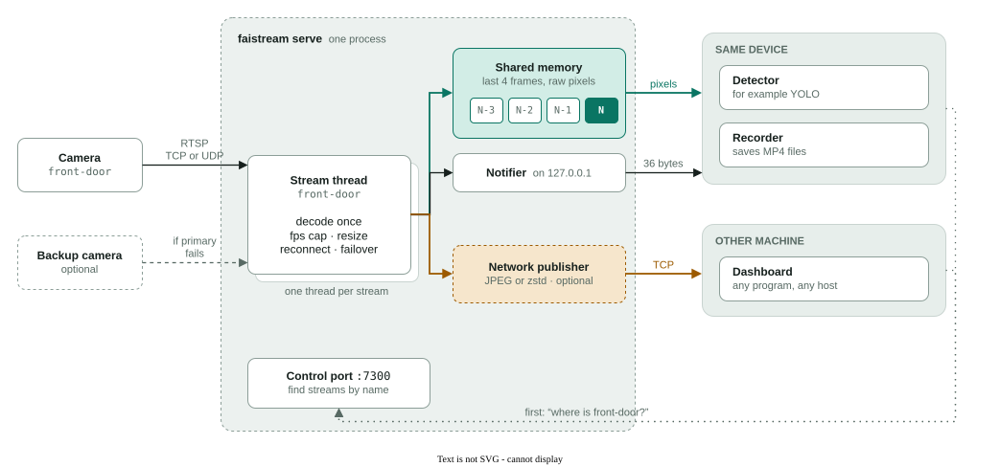
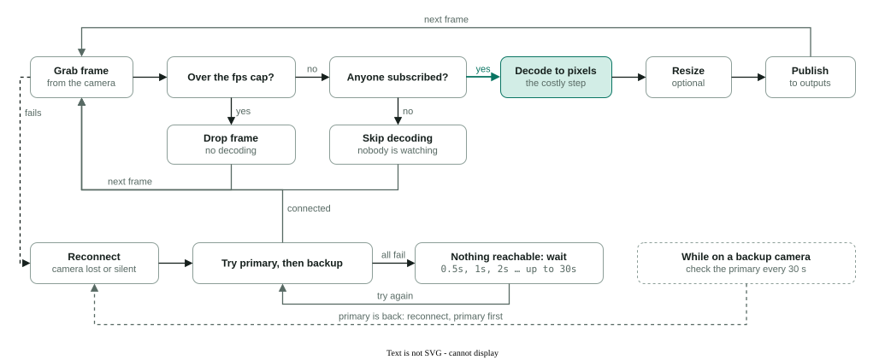
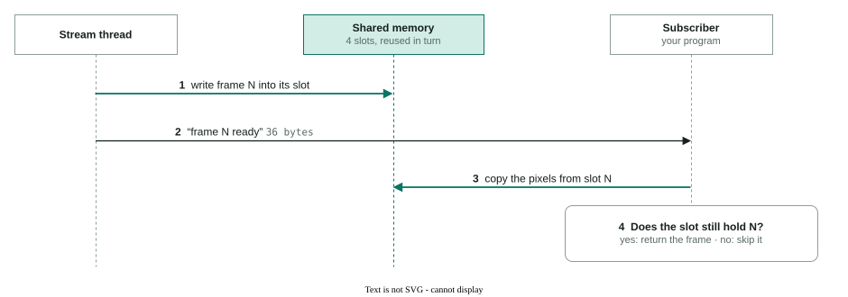
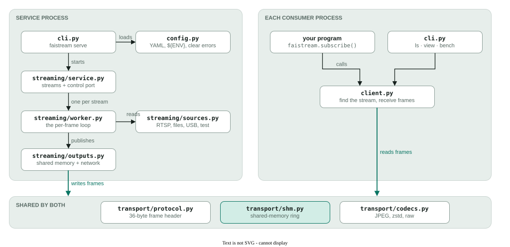

# How faistream works

faistream connects to each camera once, decodes each frame once, and hands the newest frame to every program that asks for it. Programs on the same device read the frame straight from shared memory. Programs on other machines receive it compressed over the network.

- **One connection per camera**: No matter how many programs watch it.
- **Newest frame only**: A slow program skips frames instead of falling behind.
- **Idle costs little**: With nobody watching, frames are not decoded to pixels.
- **Find streams by name**: Programs ask for `front-door`, never for a port.

Green lines are the same-device path (shared memory), amber lines the network path, dotted lines the lookup of a stream by name.

## The whole system

One service process sits between the cameras and the programs that use them. Each camera gets its own stream thread. Every frame goes to shared memory for programs on this device and, if network sharing is on, to a network publisher for other machines.

*Figure 1. One connection per camera, one decode per frame, any number of programs. The green path never copies pixels over a socket; only a 36-byte "frame N is ready" message travels. The amber path is used only when network sharing is on.*

## Inside a stream thread

Each stream thread runs the same loop for every frame. Two checks come before the expensive step: a frame over the fps cap is dropped, and if nobody is subscribed the frame is never turned into pixels. The bottom row is what happens when the camera stops sending.

*Figure 2. The per-frame loop and its recovery path. Dropped and skipped frames never reach the green "decode" step, which is where the CPU goes. Frame numbers keep increasing across reconnects and camera switches, so programs see one continuous stream.*

## How a frame reaches a program on the same device

The pixels are written once into shared memory. The program only receives a tiny message saying which frame is ready, then reads that frame directly. It checks the frame's number before and after reading, so it never uses a frame that was overwritten while it was reading.

*Figure 3. Only step 2 goes through a socket, and it carries 36 bytes. A slot is reused only after several newer frames, so an overwrite during step 3 needs a copy that takes several frame intervals; the check in step 4 catches it if it happens. Programs on other machines receive the whole frame, compressed, in step 2 instead.*

## Where it lives in the code

The same pieces, mapped to files in `src/faistream/`. The service and each program that subscribes run separately. They share only the frame format and the shared-memory ring.

*Figure 4. Arrows point from the code that calls to the code it uses. `streaming/` is the service (sources, one worker per stream, outputs, the control port) and `transport/` is the frame format it shares with subscribers. A consumer runs only `client.py` and `transport/`, so it doesn't need OpenCV unless frames arrive as JPEG. Apps can also embed the service: faicam, the camera-management web page, runs `Service` and changes its streams while it runs.*

The diagrams follow the code in [`src/faistream/`](../src/faistream/). To change them or rebuild the PDF, see [docs/README.md](README.md).
